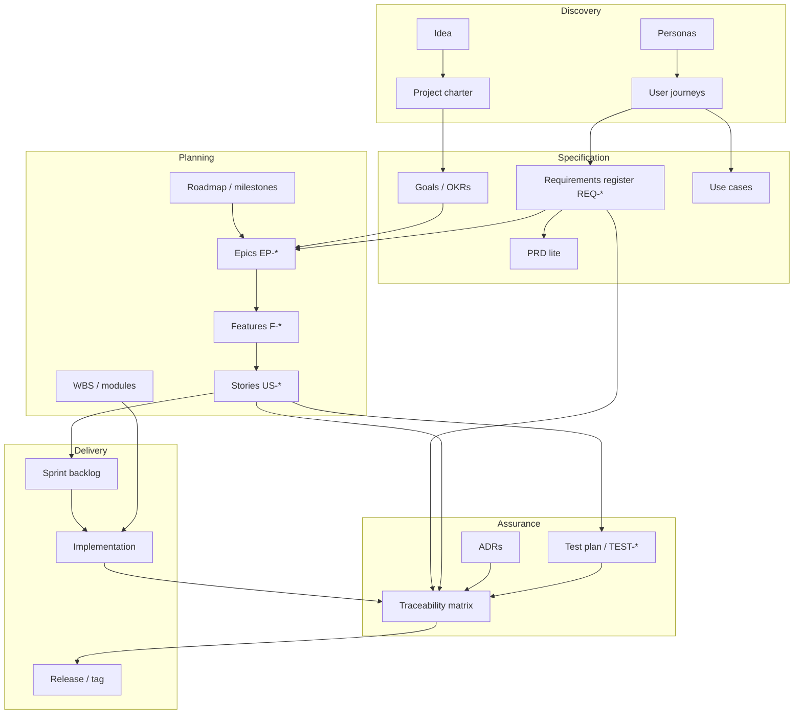

# Part 0 — Glossary & artifact map

Read this first. It connects every concept used later so nothing feels like jargon without a definition.

---

## The artifact map (how pieces link)

---

## Glossary (A–Z)

| Term | Definition |
|------|------------|
| **Acceptance criteria** | Observable conditions that must hold for a story to be done. |
| **Activity** | Work step (research, meeting); weak backlog item alone. |
| **ADR** | Architecture Decision Record — documents one technical decision and consequences. |
| **Assumption** | Belief treated as true without proof; must be validated or turned into REQ/spike. |
| **Backlog** | Ordered list of work not yet done; product vs sprint backlog. |
| **Baseline** | Frozen requirement set at a release tag. |
| **BR (business rule)** | Policy or calculation rule (e.g. refund window). |
| **Bounded context** | Domain area with consistent language and models (DDD-lite). |
| **Capability** | Product-level ability users care about (often = epic). |
| **Change impact** | Analysis of what breaks when a REQ changes. |
| **Charter** | One-page authorization to plan: user, problem, success, non-goals. |
| **CON (constraint)** | Non-negotiable technical or legal limit. |
| **Critical path** | Longest chain of dependencies → earliest finish date. |
| **DoD** | Definition of Done — checklist before “done.” |
| **DoR** | Definition of Ready — checklist before work starts. |
| **Epic** | Large body of work spanning multiple stories. |
| **Feature** | Coherent user-visible chunk inside an epic. |
| **FR** | Functional requirement — behavior the system shall perform. |
| **Gherkin** | Given/When/Then format for acceptance tests. |
| **Goal** | Measurable outcome (G-1); may map to OKRs. |
| **INVEST** | Story quality checklist (Independent, Negotiable, …). |
| **Issue** | Active problem in RAID log. |
| **JTBD** | Jobs To Be Done — progress user seeks in a situation. |
| **Kanban** | Flow-based work limits and columns. |
| **Milestone** | Outcome gate with exit criteria. |
| **MoSCoW** | Must / Should / Could / Won’t prioritization. |
| **MVP** | Smallest release that tests core hypothesis. |
| **NFR** | Non-functional requirement — quality attribute. |
| **OKR** | Objectives and Key Results — goal framing. |
| **Outcome** | User or business result (prefer over “output”). |
| **Output** | Deliverable artifact (API, screen). |
| **Persona** | Archetype user with goals and constraints. |
| **PRD** | Product Requirements Document — what/why for product. |
| **RAID** | Risks, Assumptions, Issues, Dependencies log. |
| **RICE** | Prioritization score: Reach × Impact × Confidence / Effort. |
| **Roadmap** | Time-oriented themes/milestones (not every task). |
| **RTM** | Requirements Traceability Matrix. |
| **Scrum** | Iteration-based framework (roles, events, artifacts). |
| **Slice** | Vertical end-to-end thin feature path. |
| **Spike** | Time-boxed research story with written conclusion. |
| **SRS** | Software Requirements Specification — formal REQ set. |
| **Stakeholder** | Anyone affected by or influencing the project. |
| **Story** | User story — unit of negotiable value with AC. |
| **Task** | Implementation step, usually ≤ 1 day. |
| **Theme** | Strategic grouping on roadmap (horizon, not sprint). |
| **Use case** | Actor + goal + main/alternate flows. |
| **User journey** | Steps a persona takes over time toward a goal. |
| **Verified** | REQ status: implemented and proven by test/evidence. |
| **Walking skeleton** | Minimal end-to-end path through all layers. |
| **WBS** | Work Breakdown Structure — tree of deliverables. |
| **WIP** | Work in progress — limit concurrent stories. |

---

## Naming conventions (use consistently)

| Entity | ID pattern | Example |
|--------|------------|---------|
| Goal | G-n | G-1 |
| Epic | EP-nn | EP-02 |
| Feature | F-ep-nn | F-02-03 |
| User story | US-ep-nn | US-02-03 |
| Functional REQ | REQ-FR-nn | REQ-FR-12 |
| NFR | REQ-NFR-nn | REQ-NFR-03 |
| Business rule | REQ-BR-nn | REQ-BR-01 |
| Constraint | REQ-CON-nn | REQ-CON-02 |
| Test | TEST-{unit\|e2e\|manual}-nn | TEST-E2E-05 |
| ADR | ADR-nnn | ADR-003 |
| Risk | R-nn | R-04 |
| Spike | SPIKE-nn | SPIKE-01 |

---

## Same word, different tools (do not confuse)

| Term in Jira | Term in GitHub | This guide |
|--------------|----------------|------------|
| Initiative | — | Theme / goal |
| Epic | Epic (projects) | Epic EP-* |
| Story | Issue | User story US-* |
| Sub-task | Tasklist | Task |
| Requirement | Label / custom field | REQ-* in body |

Pick one tool’s vocabulary for **execution**; keep **REQ-* ** in git docs as source of truth.

---

## Minimum artifact set (solo)

| Phase | Artifacts |
|-------|-----------|
| Before code | Charter, persona, MVP list, requirements register |
| Before sprint | Stories + AC, RTM started, RAID |
| During build | ADRs for big decisions, updated RTM |
| Before release | DoD checklist, test evidence, release notes |

Next: [Part 1 — Foundations](01-foundations.md) or follow [STUDY-PATH.md](../STUDY-PATH.md).
