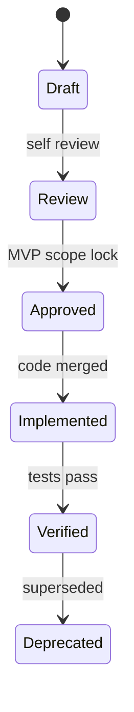

# Part 14 — Document Types & Artifacts

Different documents answer different questions. Solo projects still benefit from **lightweight versions** of each.

---

## Document comparison

| Document | Primary question | Typical length | When |
|----------|------------------|----------------|------|
| **Charter** | Why start? | 1 page | Day 0 |
| **PRD (lite)** | What product, for whom, success? | 2–5 pages | Before MVP build |
| **SRS / Requirements register** | What shall the system do? | Living table | Before & during build |
| **Use case spec** | How actors interact step-by-step? | Per feature | Complex flows |
| **User story map** | Journey order of features | 1 wall / FigJam | Prioritization |
| **RTM** | What proves each REQ? | Table | Day 1 of REQs |
| **Test plan (lite)** | How we verify release? | 1–2 pages | Before beta |
| **ADR** | Why this technical choice? | 1 page | Per big decision |
| **Runbook** | How to operate prod? | Short | Before launch |
| **Release notes** | What changed for users? | Per tag | Each release |

You do **not** need separate 100-page PDFs. One `docs/` folder with linked markdown is enough.

---

## PRD lite outline

Copy [templates/prd-lite.md](../templates/prd-lite.md).

Sections:

1. Problem & context  
2. Users & personas (link)  
3. Goals & metrics  
4. MVP scope / non-goals  
5. User journeys (summary)  
6. Requirements overview (link to register)  
7. Open questions  
8. Timeline themes (not task list)

PRD is **stable-ish**; backlog changes weekly.

---

## SRS vs requirements register

| SRS (formal) | Register (solo default) |
|--------------|-------------------------|
| Versioned document | Table in git |
| Approval signatures | Status column |
| Full shall statements | Same content |

Your [templates/requirements-register.md](../templates/requirements-register.md) **is** your SRS.

---

## Single source of truth rule

| Data | Source of truth | Mirrors |
|------|-----------------|---------|
| REQ text & IDs | `docs/requirements.md` | Issue labels `req:FR-12` |
| Trace links | `docs/traceability.md` | PR body |
| Architecture | `docs/adr/` | RTM design column |
| Sprint commitment | GitHub milestone / iteration | Not duplicated in PRD |

Never edit REQ wording only in a ticket — update register first.

---

## Document lifecycle



---

## Version headers

Each doc top:

```markdown
**Version:** 1.2  
**Status:** Approved  
**Last updated:** 2026-10-29  
**Changelog:** 1.2 — added REQ-FR-15 payment rules
```

Next: [Part 15 — Personas & journeys](15-personas-jtbd-user-journeys.md)
