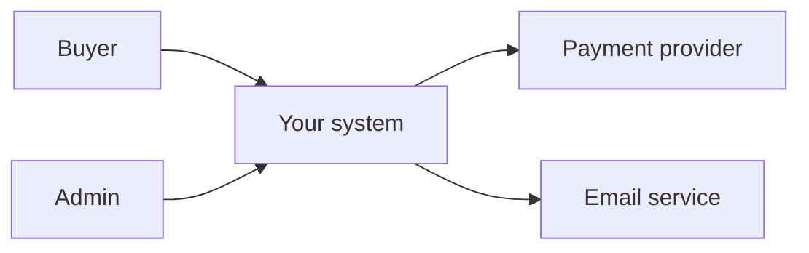
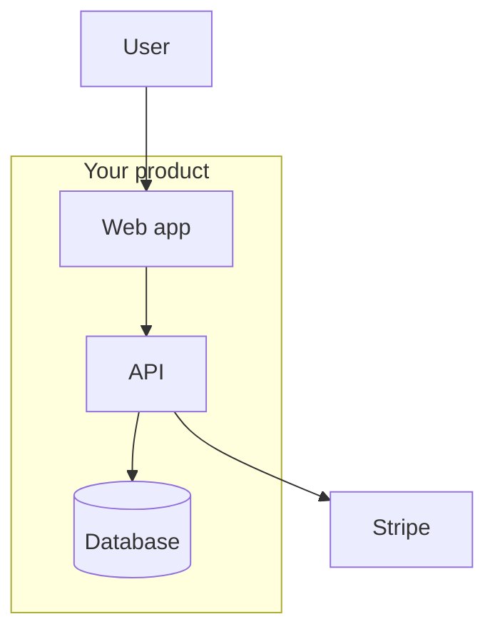
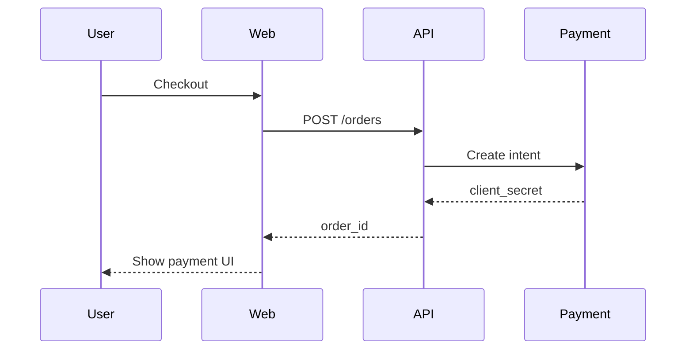
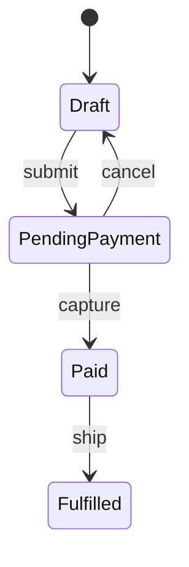

# Part 16 — Use Cases & Diagrams

Use cases complement user stories: better for **complex flows**, **multiple actors**, and **alternate paths**.

---

## When to use use case vs user story

| Use case | User story |
|----------|------------|
| Multi-step workflow | Single testable slice |
| Several actors | One primary role |
| Many alternate flows | Happy path + few errors |
| Regulated domains | Agile delivery unit |

Often: **one use case** → **many stories**.

Template: [templates/use-case.md](../templates/use-case.md)

---

## Use case structure

- **ID:** UC-01  
- **Name:** Place order  
- **Primary actor:** Buyer  
- **Preconditions:** Logged in, cart non-empty  
- **Postconditions:** Order created, payment captured  
- **Main success scenario:** numbered steps  
- **Extensions:** 3a payment fails, 3b out of stock  

Link UC-01 to REQ-FR-* in register.

---

## Context diagram (system boundary)

External systems → **dependencies** in RAID and **constraints** (REQ-CON).

---

## Container diagram (C4 level 2 — lite)

Each box can become a **module** in WBS (Part 5).

---

## Sequence diagram (one happy path)

Use for ambiguous API flows before coding.

Sequence → **tasks** under story; messages → **API requirements**.

---

## State machine (entity lifecycle)

For Order, Subscription, Invoice:

Each transition → **REQ-FR** or **REQ-BR**; invalid transitions → validation stories.

---

## Activity diagram (decision-heavy)

Use when many branches (approval workflows). Mermaid `flowchart` with diamonds for decisions.

---

## Diagram → RTM

Add RTM column or footnote: **Design ref:** UC-02, diagram in `docs/diagrams/checkout.md`.

Next: [Part 17 — Testing & verification](17-testing-quality-verification.md)
