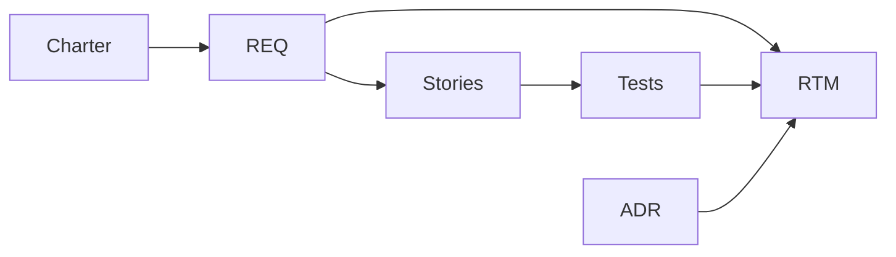
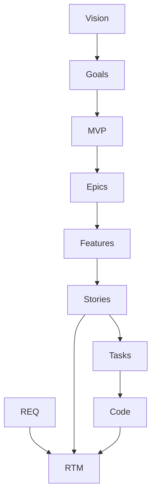
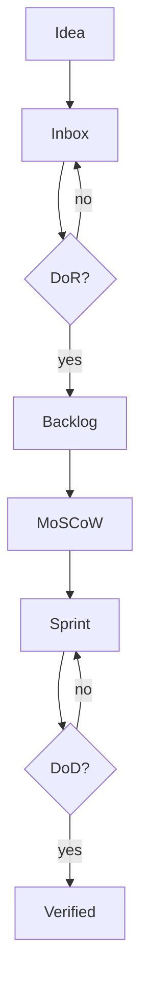

# Part 27 — Visual Maps Reference (Mermaid)

Copy-paste into your repo `docs/diagrams/`.

---

## Artifact dependency (study order)

---

## Decomposition ladder

---

## Prioritization flow

---

## Release pipeline

Use diagrams in PRD appendix for onboarding collaborators.

Next: [FAQ & cheat sheet](99-faq-antipatterns-cheatsheet.md)
